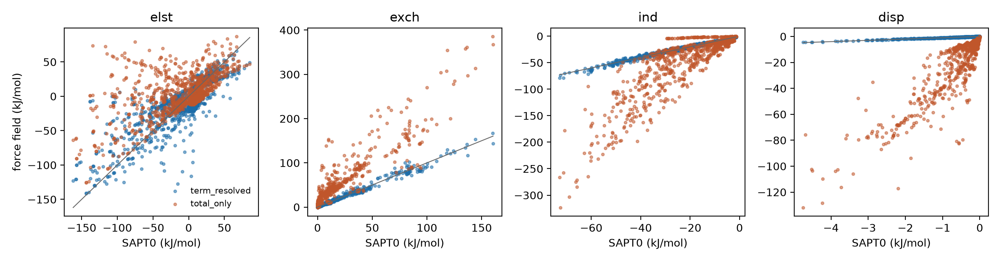
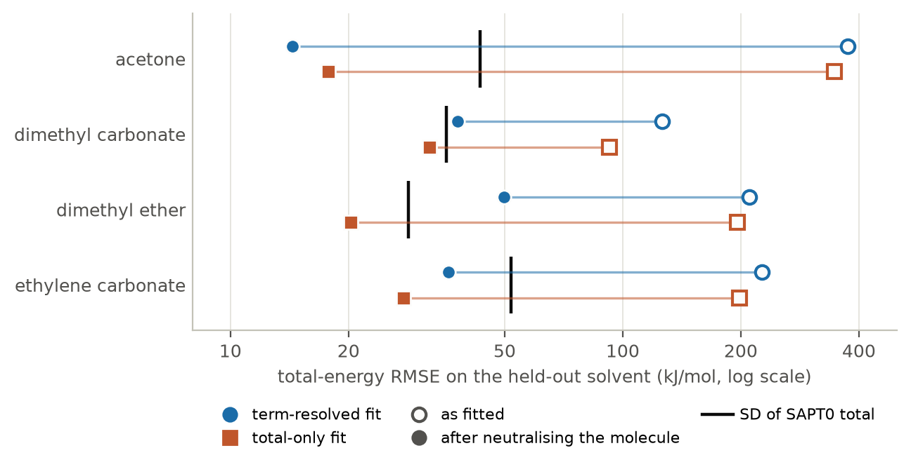
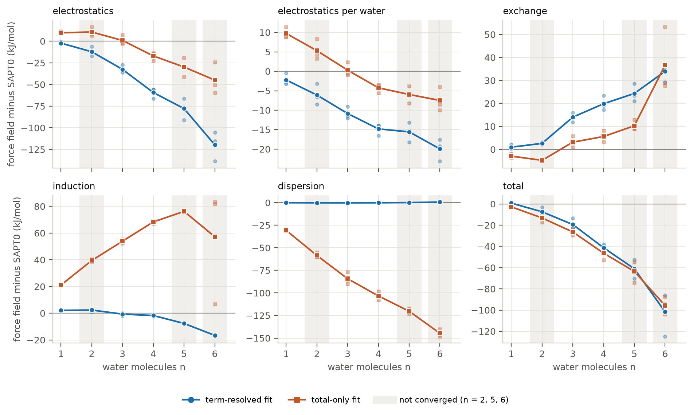
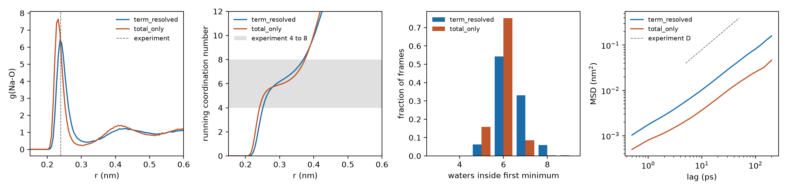

# ionff

A small, complete reference, fit and validate loop for the interaction of Na+ with solvent molecules. It generates quantum chemistry reference data (SAPT0), fits analytic force field terms to it, tests how well the terms transfer to solvents that were not in the fit, and runs molecular dynamics of Na+ in water to compare with experiment. Everything is plain Python plus one small C++ header, and every step can be restarted.

The question behind it is narrow. SAPT0 splits an interaction energy into electrostatics, exchange, induction and dispersion. A force field can be fitted to each component separately, or only to their sum. Fitting the sum is common, and it can look accurate while the individual terms are wrong in ways that cancel. This repository fits the same functional forms both ways on the same data so the two can be compared directly.

This is a prototype. The fits give large errors on solvents that were not in the fit, mostly because the unseen molecule comes out charged (see Results), and the diffusion coefficient of Na+ in water is well below experiment. The Results and Limits sections give the numbers.

## What is in the repository

| Path | Content |
|---|---|
| `src/ionff/` | The package: atom typing, the four analytic terms, geometry sampling, SAPT0 driver, fitting, evaluation, cluster test, OpenMM MD analysis |
| `scripts/` | One driver per step, settings as constants at the top of each file |
| `tests/` | Unit tests, including fit recovery on synthetic data |
| `cxx/` | Header-only C++17 version of the four terms with a CMake test |
| `hpc/` | Environment setup and PBS job scripts |
| `data/monomers/` | Optimised solvent geometries (B3LYP/def2-SVP) |
| `data/reference/` | SAPT0 results as JSON lines, written by the scripts |
| `results/` | Fitted parameters, summaries, figures and `REPORT.md`, written by the scripts. The raw MD trajectories (`results/md/*.npz`) are not included, see Results |

## The model

Na+ interacts with each atom of a solvent molecule through four pair terms, with r in Angstrom, energies in kJ/mol and charges in e.

- Electrostatics: a Slater-smeared Coulomb term, K q / r (1 - exp(-beta r)(1 + beta r)), with K = 1389.35457520.
- Exchange: Born-Mayer, A exp(-B r).
- Induction: -K alpha / (2 r^4), multiplied by a Tang-Toennies damping function of order 4.
- Dispersion: -C6 / r^6, multiplied by a Tang-Toennies damping function of order 6.

Parameters are shared by atom type. There are nine types: OW, HW (water), OH, HO (hydroxyl), OC (carbonyl oxygen), OE (ether or ester oxygen), CC (carbonyl carbon), CA (alkyl carbon) and H. Types are assigned from the geometry alone. The six solvents are water, methanol, dimethyl ether, ethylene carbonate, dimethyl carbonate and acetone.

Fitting uses differential evolution (Sobol start) followed by a bounded least-squares polish. The electrostatic and total fits carry a soft penalty that keeps each molecule close to neutral, 20 kJ/mol per elementary charge.

## Steps

1. `scripts/make_monomers.py` builds the six monomers with RDKit and optimises them with psi4. The outputs are already in `data/monomers/`, so this only needs rerunning to change the geometries.
2. `scripts/run_reference.py` places Na+ around each monomer along lone pair, bisector and sphere directions at six distances from 2.0 to 4.5 Angstrom, drops points closer than 1.7 Angstrom to any atom, and runs SAPT0/aug-cc-pVDZ with density fitting and a frozen core. This gives 984 points. The run appends to a JSON lines file and skips points it has already done.
3. `scripts/run_fit.py` fits term-resolved and total-only parameters, scores them, and runs leave-one-solvent-out. A solvent is held out only if the atom types it contains also appear in the remaining solvents. Water and methanol are therefore skipped, because OW, HW, OH and HO occur nowhere else. Reference points with a total energy above 60 kJ/mol are left out of the fits.
4. `scripts/run_clusters.py` relaxes Na+(H2O)n for n = 1 to 6 (B3LYP/def2-SVP) together with two perturbed structures per size, and computes SAPT0 of the whole water cluster against Na+. `scripts/run_cluster_test.py` compares this with the force field summed pairwise over the waters. At n = 6 the term-resolved error is mostly electrostatics (-119.7 of -101.7 kJ/mol total), not the induction non-additivity (-16.6 kJ/mol) that a pair-additive model was expected to miss. The electrostatic error is not a constant offset per water: its mean per water grows from -2.2 kJ/mol at n = 1 to -20.0 kJ/mol at n = 6. Distortion of the water molecules does not explain it, because the relaxed structures stay close to the monomer geometry (mean O-H 0.966 to 0.971 Angstrom and mean H-O-H 103 to 107 degrees, against 0.967 Angstrom and 103.1 degrees in the monomer file). Whether the rest is non-additivity of the SAPT0 electrostatics or a misfit of the single-water terms has not been tested. SAPT0 of Na+ against each single water taken from the cluster geometries would separate the two.
5. `scripts/run_md.py` replaces some waters in an SPC/E box (OpenMM, PME) by Na+, adds the fitted Na+ to water terms as a short-range correction, runs NPT equilibration followed by NVE production, and reports the Na-O radial distribution function, the first-shell coordination number and the self-diffusion coefficient. The coordination number is the running integral at the first minimum of g(r). The diffusion coefficient comes from the Einstein relation with the Yeh-Hummer finite-size correction. `ionff.md.diffusion` gives a per-run error from four blocks of the run (MSD fit window 5 ps to 100 ps). The table below instead reports the standard error over seeds from `scripts/analyze_md.py`, which fits the MSD between 10 ps and 80 ps. Experimental values for comparison are Na-O near 0.24 nm, a coordination number of 4 to 8, and D = 1.33e-9 m2/s at 298 K.
6. `scripts/make_report.py` collects the JSON outputs into `results/REPORT.md`.
7. `scripts/make_readme_figures.py` draws `results/fig_loso_neutralised.png` and `results/fig_cluster_components.png` from the JSON files. The other figures in the README come from `scripts/run_fit.py` (`fig_term_parity.png`) and `scripts/analyze_md.py` (`fig_md.png`). `results/fig_loso.png` (raw LOSO bars) and `results/fig_clusters.png` (total and induction only) are still written by their scripts and are superseded in the README by Figures 2 and 3.

## Running it

Create the environment and run the tests:

```
conda env create -f environment.yml
conda activate ionff
pip install -e ".[test]"
pytest -m "not slow"
```

A short local check of the whole chain needs only `python scripts/run_reference.py water`, then `python scripts/run_fit.py` on the partial data. The full scan and the cluster calculations are better run on a cluster. `hpc/setup_env.sh` builds the environment once (`hpc/setup_env.pbs` runs it on a compute node), and the PBS scripts in `hpc/` run the scan (one array task per solvent), the clusters (one per size), the fit and the MD (one per seed and parameter set, on CPU). They are written for a PBS Pro system and the queue and resource lines will need adjusting elsewhere. `hpc/fit.pbs` concatenates the per-task files itself. To do it by hand after the array jobs:

```
cat data/reference/sapt0_scan_*.jsonl > data/reference/sapt0_scan.jsonl
cat data/reference/sapt0_clusters_*.jsonl > data/reference/sapt0_clusters.jsonl
```

All reference runs are resumable, so a job that hits its walltime can be submitted again unchanged.

## C++ kernel

`cxx/include/ionff_terms.hpp` implements the four terms and the pair-additive sum in C++17. `cxx/tests/test_terms.cpp` compares it with 400 rows of reference values that `scripts/make_golden.py` writes from the Python code, and `tests/test_golden.py` checks that the file still matches Python. Build and test with:

```
cmake -S cxx -B build
cmake --build build
ctest --test-dir build
```

The kernel is small and is not called by the fitting or MD code. It exists as a tested starting point for moving the energy evaluation out of Python.

## Results

The numbers below are copied from `results/REPORT.md` and the JSON files next to it. Energies are in kJ/mol.

**Fit to the SAPT0 scan (973 points, RMSE).** The term-resolved fit reaches 25.28 for electrostatics, 2.90 for exchange, 1.80 for induction, 0.08 for dispersion and 25.13 for the total. The total-only fit reaches 13.62 for the total, but its component errors are 41.05, 39.96, 46.78 and 26.94. The lower total error comes with wrong components. The term-resolved fit does not give a lower total error.



*Figure 1. Force field energy against SAPT0 energy for each term, one point per scan point, for both fits. Points on the grey diagonal are reproduced exactly. The term-resolved fit (blue) lies close to the diagonal for exchange, induction and dispersion and scatters for electrostatics (RMSE 25.28). The total-only fit (orange) is scattered in every panel, with component RMSEs of 41.05, 39.96, 46.78 and 26.94, although its total is closer to SAPT0 (13.62 against 25.13).*

**Leave one solvent out (RMSE of the total energy, term-resolved / total-only).** Acetone 374.07 / 345.99, dimethyl carbonate 126.23 / 92.43, dimethyl ether 210.62 / 195.99, ethylene carbonate 226.80 / 198.18. Water and methanol are skipped. Taken at face value neither fit transfers to an unseen solvent, and the total-only fit has the lower error in all four cases.

The failure is electrostatic. For the term-resolved fit the held-out RMSE of exchange, induction and dispersion is at most 4.58, while the electrostatic RMSE is 373.46, 124.78, 212.26 and 228.41 (same solvent order). Most of that comes from a net charge on the unseen molecule. The neutrality penalty acts on the training molecules only, so the fitted type charges leave the held-out molecule with a net charge of +1.09 e (acetone), -0.51 e (dimethyl carbonate), +0.56 e (dimethyl ether) and -0.70 e (ethylene carbonate) for the term-resolved fit. `scripts/run_loso_neutral.py` repeats the test after shifting the type charges that occur in the held-out molecule by one common amount so that it is neutral (`results/loso_neutralised.json`). The last column is the standard deviation of the SAPT0 total on that solvent, which is the RMSE of predicting the mean.

| held out | net charge before shift (e) | total RMSE term-resolved | total RMSE total-only | SD of SAPT0 total |
|---|---|---|---|---|
| acetone | +1.09 | 14.37 | 17.78 | 43.2 |
| dimethyl carbonate | -0.51 | 37.90 | 32.20 | 35.5 |
| dimethyl ether | +0.56 | 49.87 | 20.26 | 28.4 |
| ethylene carbonate | -0.70 | 35.98 | 27.57 | 51.9 |

After the shift the total-only fit is below the spread of the reference in all four cases. The term-resolved fit is below it for acetone and ethylene carbonate and above it for dimethyl carbonate and dimethyl ether. The total-only fit has the lower error in three of the four cases, and acetone is the exception. So most of the large errors above are a net charge, and the transfer of the term-resolved fit remains unsettled. The shift is one arbitrary way to neutralise a molecule, and a user of the force field would have to assign the charges of a new molecule without access to its SAPT0 data. The table therefore shows how much of the original failure is net charge. It does not show that the model transfers.



*Figure 2. Total-energy RMSE on each held-out solvent, on a log scale. Open markers are the values as fitted (quoted in the first paragraph above) and filled markers are the values after the neutralising shift (the table). The black tick is the standard deviation of the SAPT0 total on that solvent, so a filled marker to the left of the tick beats predicting the mean. The long segments show how much of the original error is net charge. The total-only fit (orange squares) is left of the tick in all four cases and the term-resolved fit (blue circles) in two, acetone and ethylene carbonate.*

**Na+(H2O)6 (mean of three structures, SAPT0 total -403.2).** Force field minus SAPT0:

| fit | electrostatics | exchange | induction | dispersion | total |
|---|---|---|---|---|---|
| term-resolved | -119.7 | +34.0 | -16.6 | +0.7 | -101.7 |
| total-only | -44.9 | +36.6 | +57.3 | -144.7 | -95.8 |

Both fits miss the total by about 100, in the sense that the force field binds more strongly than SAPT0. The total-only fit carries large induction and dispersion errors that partly cancel. The remaining term-resolved error is mostly electrostatic and grows with cluster size, see step 4. The n = 2, 5 and 6 structures are not converged minima, see Limits.



*Figure 3. Force field minus SAPT0 for Na+(H2O)n, n = 1 to 6, split by energy term. Lines join the mean of three structures per size and the faint points are the single structures. The grey bands mark the sizes that are not converged minima. The electrostatic error of the term-resolved fit (blue) grows with n and, per water, from -2.2 kJ/mol at n = 1 to -20.0 kJ/mol at n = 6, while its dispersion error stays near zero and its induction error reaches -16.6 at n = 6. The total-only fit (orange) reaches a similar total error through large induction (+57.3 at n = 6) and dispersion (-144.7) errors that partly cancel.*

**Na+ in SPC/E water (4 seeds, 4 Na+ per box, mean +/- standard error over seeds).** Experiment: Na-O 0.24 nm, coordination 4 to 8, D = 1.33e-9 m2/s at 298 K.

| parameters | Na-O peak (nm) | first minimum (nm) | coordination | D raw (1e-9 m2/s) | D corrected (1e-9 m2/s) |
|---|---|---|---|---|---|
| term-resolved | 0.239 +/- 0.001 | 0.315 +/- 0.001 | 6.44 +/- 0.03 | 0.139 +/- 0.007 | 0.426 +/- 0.006 |
| total-only | 0.231 +/- 0.001 | 0.304 +/- 0.002 | 5.96 +/- 0.02 | 0.043 +/- 0.005 | 0.332 +/- 0.006 |

The peak position and the coordination number are consistent with experiment. The corrected diffusion coefficient is about 3 to 4 times too low. Most of the corrected value is the finite-size term: the Yeh-Hummer correction adds about 0.29 to the raw value for a box of about 3 nm (0.287 and 0.289 from the table), which is two thirds of the corrected D for the term-resolved parameters and nearly nine tenths for the total-only ones. The raw values, 0.139 and 0.043, are about 10 and 31 times below experiment.



*Figure 4. Bulk Na+ in SPC/E water, pooled over the seeds. From left to right: the Na-O radial distribution function, with the experimental peak position of 0.24 nm dashed; the running coordination number, with the experimental range of 4 to 8 shaded; the fraction of frames with each number of waters inside the first minimum; and the mean squared displacement against lag time, with the line for the experimental D. The MSD is the raw value without the finite-size correction, so it lies below the experimental line by about the factor given for the raw D above.*

**Raw MD data.** The trajectory files `results/md/*.npz` (about 75 MB) are not in the repository. `scripts/analyze_md.py` reads them, so `results/md_pooled.json` and the MD table cannot be regenerated without rerunning `scripts/run_md.py`. The per seed summaries, the g(r) files and `md_pooled.json` are included.

## Limits

These matter when reading any result from this repository.

- The monomers are rigid and the Na+ to solvent energies are gas phase SAPT0 values with a medium sized basis set. Condensed phase polarisation is not part of the reference.
- The model is pair additive. The cluster test measures how much that costs for water, and the MD uses the pair terms only.
- The MD is a hybrid. Water to water interactions and long range electrostatics are SPC/E with PME, and the fitted Na+ to water terms act inside a 1.0 nm cutoff with a switch from 0.9 nm. The fitted charges are not the SPC/E charges, so the correction is truncated at the cutoff. Na+ Lennard-Jones parameters are removed.
- The scan points are correlated, since several share a direction and differ only in distance. Reported errors are fit errors on this set and not independent estimates of generalisation. Leave-one-solvent-out is the transfer test, and with six solvents and a shared type table it covers only part of the set. Its held-out molecules are charged unless the shift in `scripts/run_loso_neutral.py` is applied, see Results.
- The fits use one random seed. For the electrostatic term, refits with seeds 0 to 3 gave the same RMSE (25.28) and the same cluster errors, so that term does not depend on the seed. The other terms and the total-only fit were not rerun with other seeds.
- Many fitted parameters sit on a bound of the search range (15 for the term-resolved fit and 17 for the total-only fit, for example C6 = 5000, alpha = 3 and d = 5 for several atom types). Those parameters are not determined by the data, and the fits should not be read as unique solutions.
- The soft neutrality penalty keeps molecules only approximately neutral. In the term-resolved fit the net charge of dimethyl ether is -0.16 e.
- The MD box carries a net charge of +4 e (four Na+ and no counter-ions), which PME neutralises with a uniform background. The finite-size correction is large: it adds about 0.29e-9 m2/s, which is 67 to 87 percent of the corrected D. The value of D therefore depends mostly on the correction and not on the fitted parameters.
- Each MD box has 4 Na+ ions and the error is taken over 4 seeds, so the standard errors in the table are rough. The first-shell coordination number depends on where the minimum of g(r) is taken.
- The cluster relaxation is capped at 200 optimiser steps. If a cluster does not converge, the last geometry is kept and the record carries `"converged": false`. In `data/reference/sapt0_clusters.jsonl` this applies to n = 2, 5 and 6 (9 of the 18 records), so the n = 6 row above is not at a minimum. The perturbed structures inherit the flag. They are made by adding Gaussian noise of 0.08 Angstrom to every water coordinate, which also distorts the water molecules themselves (O-H lengths from 0.78 to 1.23 Angstrom at n = 6). The rigid water model cannot represent this, so part of the force field error on the perturbed structures comes from the distortion.

## License

MIT. See `LICENSE`.
